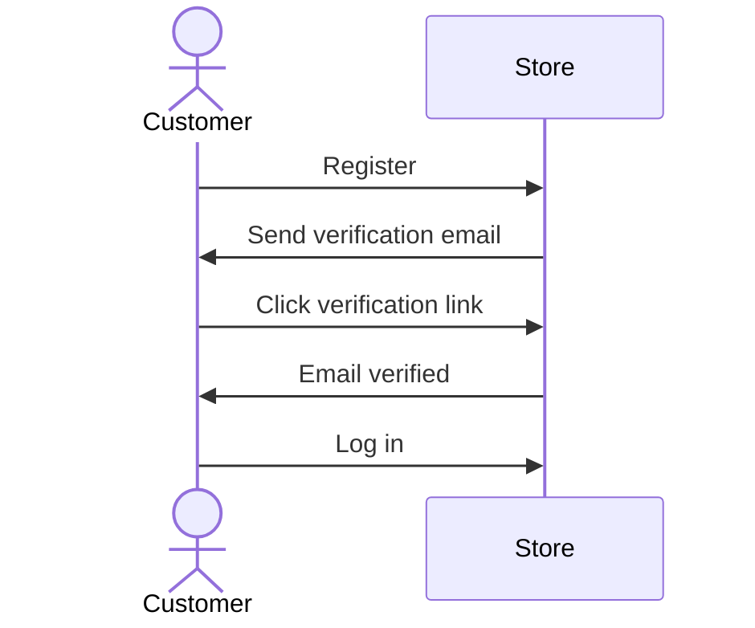

import { Prerequisites, Note } from "docs-ui"

export const metadata = {
  title: `Send Email Verification Notification`,
}

# {metadata.title}

In this guide, you'll learn how to enable email verification requirement for customers in your MedusaGo application, and how to send email verification notifications.

<Prerequisites
  items={[
    {
      text: "Medusa v2.16.0 or later",
      link: "!docs!/learn/update"
    },
    {
      text: "Notification Module Provider for the email channel, such as SendGrid or Resend",
    }
  ]}
/>

## How Email Verification Works

By default, customers can register an account and log in to your MedusaGo store without verifying their email address. You can enable email verification to require customers to verify their email address before they can log in.

When email verification is enabled, the customer registration flow changes to the following:



1. A customer registers an account by providing their email and password.
2. The customer receives an email with a verification link. The link points to a page in your storefront that verifies the customer's email when visited.
3. The customer clicks the verification link, which verifies their email address and completes the registration process.
4. The customer can now log in to their account.

This guide focuses on the backend implementation of this flow, which involves enabling email verification and sending the verification email.

To implement the storefront part of the flow, refer to the [Verify Customer Account in Storefront guide](../../../storefront-development/customers/verify-account/page.mdx).

---

## Send Email Verification Notification

When the storefront requests to send an email verification notification, Medusa emits the `auth.verification_requested` event. You can listen to this event in a [subscriber](!docs!/learn/fundamentals/events-and-subscribers) to send the email verification notification.

<Note>

The `auth.verification_requested` event payload changed in Medusa v2.17.0. The `actor_type` and `provider_identity_id` fields were removed, `provider` was renamed to `code_provider`, and `entity_type` was added. If you have a subscriber written before v2.17.0, update it to use the payload described in this guide.

</Note>

### Prerequisite Configurations

#### Event Payload

This subscriber receives in the event payload an object with the following properties:

- `entity_id`: The identifier of the provider identity to verify. For email verification, this is the customer's email address.
- `entity_type`: The kind of entity being verified, such as `email`. You check that it's `email` before sending the notification, since you only want to handle email verifications.
- `code`: The verification code to include in the verification link. When the customer clicks the verification link, the storefront should send the code back to the MedusaGo application to verify the customer's email address.
- `code_provider`: The verification provider used to generate the code. By default, this is `token`.
- `auth_identity_id`: The ID of the auth identity for which the verification was requested.
- `expires_at`: The date and time at which the verification code expires.
- `metadata`: Optional metadata included in the verification request.

#### Subscriber Implementation

In the subscriber, you first check that the `entity_type` is `email` to only handle email verifications. Then, you format the storefront URL either using the value of `admin.storefrontUrl` set in `medusa-config.go` or a placeholder URL. You need this URL to format the verification link sent in the email.

Then, you send a notification using the Notification Module's main service. You pass the following properties to the `createNotifications` method:

- `to`: The email address of the customer to which the verification email should be sent.
- `channel`: The channel to send the notification through. In this case, it's `email`.
- `template`: The ID of the template to use for the notification. This depends on your Notification Module Provider. For example, if you're using the SendGrid Notification Module Provider, this should be the ID of a SendGrid template that you've set up to format the email verification notification.
- `data`: The data to be passed to the template when sending the notification. In this case, you pass the `verification_url` property, which contains the verification link to be included in the email.

The verification link points to a page in your storefront, such as `/verify-account`, which should handle verifying the customer's email when visited.

---

## Handle Email Verification in Storefront

When the customer clicks the verification link, they should be directed to a page in your storefront that sends the token back to the MedusaGo application to verify the customer's email address.

To learn how to implement this part of the flow, refer to the [Verify Customer Account in Storefront guide](../../../storefront-development/customers/verify-account/page.mdx).

---

## Example Notification Templates

The following section provides example notification templates for some Notification Module Providers.

### SendGrid

<Note>

Refer to the SendGrid Notification Module Provider documentation for more details on how to set up SendGrid.

</Note>

The following HTML template can be used with SendGrid to send an email verification email:

```html
<!DOCTYPE html>
<html>
<head>
    <meta charset="utf-8">
    <meta name="viewport" content="width=device-width, initial-scale=1.0">
    <title>Verify Your Email</title>
    <style>
        body {
            font-family: -apple-system, BlinkMacSystemFont, 'Segoe UI', 'Roboto', 'Oxygen', 'Ubuntu', 'Cantarell', 'Fira Sans', 'Droid Sans', 'Helvetica Neue', sans-serif;
            background-color: #ffffff;
            margin: 0;
            padding: 20px;
        }
        .container {
            max-width: 465px;
            margin: 40px auto;
            border: 1px solid #eaeaea;
            border-radius: 5px;
            padding: 20px;
        }
        .header {
            text-align: center;
            margin: 30px 0;
        }
        .title {
            color: #000000;
            font-size: 24px;
            font-weight: normal;
            margin: 0;
        }
        .content {
            margin: 32px 0;
        }
        .text {
            color: #000000;
            font-size: 14px;
            line-height: 24px;
            margin: 0 0 16px 0;
        }
        .button-container {
            text-align: center;
            margin: 32px 0;
        }
        .verify-button {
            background-color: #000000;
            border-radius: 3px;
            color: #ffffff;
            font-size: 12px;
            font-weight: 600;
            text-decoration: none;
            text-align: center;
            padding: 12px 20px;
            display: inline-block;
        }
        .verify-button:hover {
            background-color: #333333;
        }
        .url-section {
            margin: 32px 0;
        }
        .url-link {
            color: #2563eb;
            text-decoration: none;
            font-size: 14px;
            line-height: 24px;
            word-break: break-all;
        }
        .disclaimer {
            margin: 32px 0;
        }
        .disclaimer-text {
            color: #666666;
            font-size: 12px;
            line-height: 24px;
            margin: 0 0 8px 0;
        }
        .security-footer {
            margin-top: 32px;
            padding-top: 20px;
            border-top: 1px solid #eaeaea;
        }
        .security-text {
            color: #666666;
            font-size: 12px;
            line-height: 24px;
            margin: 0;
        }
    </style>
</head>
<body>
    <div class="container">
        <div class="header">
            <h1 class="title">Verify Your Email</h1>
        </div>

        <div class="content">
            <p class="text">
                Hello,
            </p>
            <p class="text">
                Thanks for creating an account. Please confirm your email address by clicking the button below to complete your registration.
            </p>
        </div>

        <div class="button-container">
            <a href="{{verification_url}}" class="verify-button">
                Verify Email
            </a>
        </div>

        <div class="url-section">
            <p class="text">
                Or copy and paste this URL into your browser:
            </p>
            <a href="{{verification_url}}" class="url-link">
                {{verification_url}}
            </a>
        </div>

        <div class="disclaimer">
            <p class="disclaimer-text">
                This verification link will expire soon for security reasons.
            </p>
            <p class="disclaimer-text">
                If you didn't create an account, you can safely ignore this email.
            </p>
        </div>

        <div class="security-footer">
            <p class="security-text">
                For security reasons, never share this verification link with anyone. If you're having trouble with the button above, copy and paste the URL into your web browser.
            </p>
        </div>
    </div>
</body>
</html>
```

Make sure to pass the `verification_url` variable to the template, which contains the URL to verify the customer's email.

You can also customize the template further to show other information.
